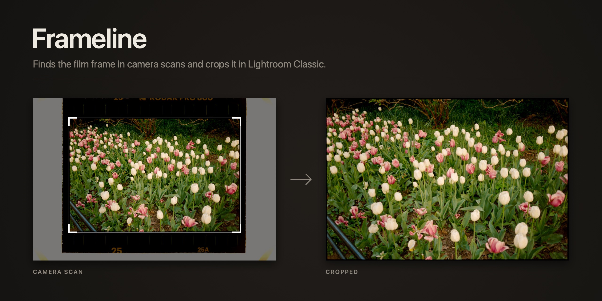
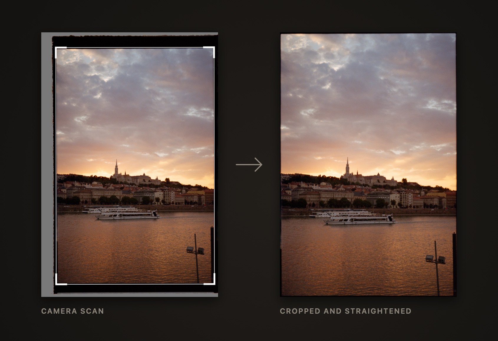
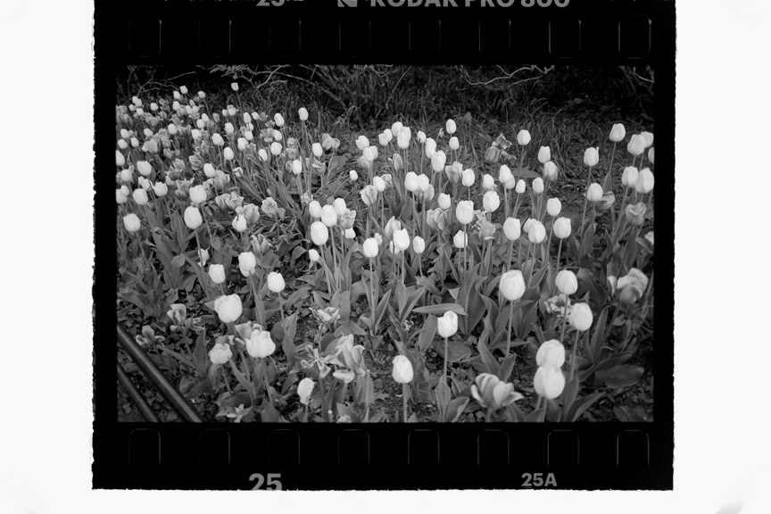
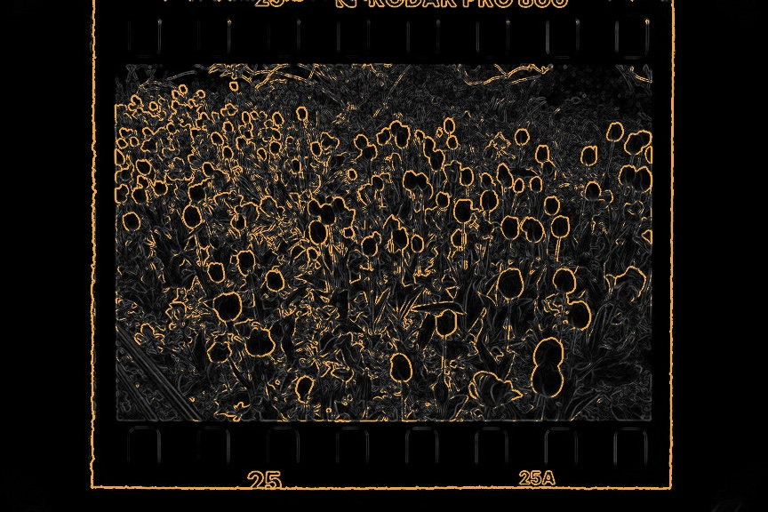
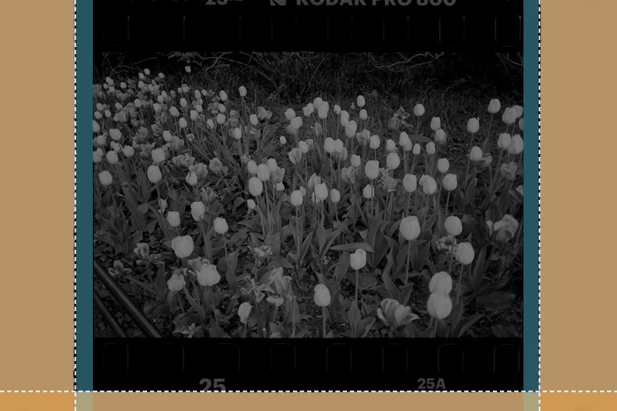
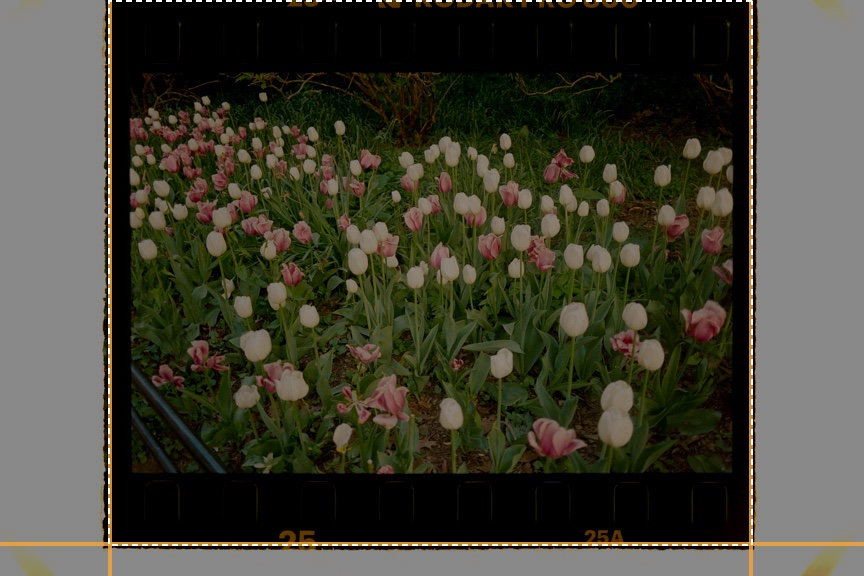
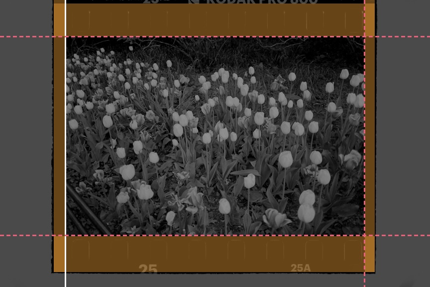
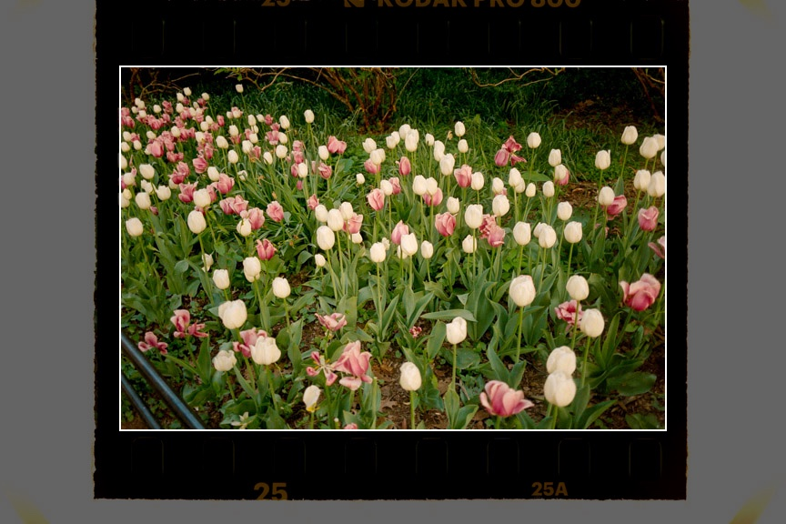

# Frameline



Frameline is a free Lightroom Classic plug-in for people who scan film with a
digital camera. Select your scans and press control-F. Each scan is cropped
to the film frame, and straightened if the frame sat a little crooked in the
holder. The holder and film border are cropped away, leaving just the
picture.

The crops are ordinary Lightroom crops. Nothing is baked in: press R to
adjust one by hand, or undo it like any other edit.

## What it handles

- **Negatives and positives.** Run it before or after you convert your
  negatives.
- **Messy edges.** A holder that shows on some sides and not others, ragged
  film edges, and borders that are thin, black, grey or orange.
- **Tilted frames.** It measures the tilt from the frame's long edges and
  straightens the crop to match.
- **A side it can't see.** Take a night sky running into a black border: a
  35mm frame is 3:2, so the other three sides tell it where the fourth
  must be.
- **Whole strips on a light table**, sprocket holes, edge print and all. It
  finds the strip first, then the frame inside it.
- **A whole roll at once.** Every selected photo goes through the detector
  in one pass, so it's quick once Lightroom has built its previews.



## Install

1. Download this repository (Code › Download ZIP) and unzip it somewhere
   you'll keep it. Lightroom runs the plug-in from that folder.
2. In Lightroom Classic, open File › Plug-in Manager, click Add, and choose
   the `frameline.lrplugin` folder.
3. Restart Lightroom once. The control-F shortcut starts working after the
   restart.

Frameline needs a Mac with Apple Silicon.

The frame detector is a small program inside the plug-in folder. It isn't
signed by a registered Apple developer, so macOS may block it the first
time. If that happens, run this once in Terminal, with the path to where
you unzipped it:

```bash
xattr -dr com.apple.quarantine ~/path/to/frameline.lrplugin
```

You can also build the detector yourself (see
[Building from source](#building-from-source)). macOS doesn't block a
program you built yourself.

## Using it

Select some scans and press **control-F**, or choose File › Plug-in Extras ›
Frameline. A short message tells you how many were cropped.

If Frameline was unsure about one edge of a photo, it still crops it. It
also adds the photo to **Collections › Frameline › Worth a look** so you can
check it. If it couldn't find the frame at all, it leaves the photo alone
and adds it to **Frameline › Skipped**.

To change a crop, select photos Frameline has cropped and press control-F
again. A review window opens. Pick a different crop edge or film format and
the crop moves while you watch. **Make this my default** saves the choice
for future runs, and **Remove crop** undoes the crop. If you select cropped
and uncropped photos together, only the uncropped ones are cropped and the
rest are left as they are.

### Crop edge

How much of the film border to keep around the picture:

| Crop edge | What you get |
|---|---|
| Tighter | Cuts 0.6% into the picture |
| Tight | Cuts 0.3% into the picture |
| Edge to edge | Exactly on the frame edge |
| **Thin border** (default) | A thin line of film border, 0.5% |
| Wide border | 1.2% of border |
| Chonk border | 2.5% of border |
| Sprockets | The frame plus the sprocket holes, cropped to 9:8. Needs a scan that shows the whole strip. |

Percentages are of the photo's width or height. Opposite sides get the same
border, so the picture stays centred. A side never shows more
border than the scan actually has, so on a tight holder a wide border can
come out thinner than you asked for.

### Settings

File › Plug-in Extras › **Frameline Settings…** has the defaults: crop
edge, whether to straighten tilted frames, film format, an optional colour
label for photos worth a look, and the shortcut key.

The formats are 35mm, half frame, 6×4.5, 6×6, 6×7 and 6×9. The format
tells Frameline the frame's shape, and the crop keeps that shape exactly.
"Free" keeps the edges where they were detected.

## Tips

- **Leave some film border showing on every side** when you scan.
  Frameline finds the frame by its border. If a frame runs off the edge of
  the scan on two sides, it gets skipped.
- **Crop before you convert.** In testing, Frameline ran much faster on
  negatives before conversion than after. Negative Lab Pro also reads the
  colours inside the crop, so it does better when the border and holder
  are already cropped out.

## How it works

Every camera scan has the same layers, from the outside in: the holder (if
it shows), the film's border, then the picture. The border is unexposed
film, so it's one flat tone, the same on all four sides. The holder usually
shows on fewer sides.

Here's the tulip scan from the top of this page going through it, step by
step. The pictures come from Frameline's own code run on that scan
(`tools/stages.sh` draws them).

### 1. A small gray copy



Frameline drops the colour and works on a gray copy no more than 900 pixels
across, which is plenty to find an edge and keeps a whole roll quick. Gray
runs from 0 (black) to 255 (white). Here the light table reads 249 and the
film's black border reads 0.

### 2. Where the brightness changes



For each pixel, Frameline measures how fast the brightness changes. The
strongest 5% (orange) count as edge pixels. Tulip outlines and the film's
outer edge light up, while flat areas like the light table and the black
border stay dark.

### 3. Walking in from each side



From each edge of the scan, Frameline reads inward one line at a time. It
looks for *runs*: lines in a row that are all one flat tone, like a holder,
a light table or film border. The tone found on the most sides counts as
the border. Here that's the light table (orange) on the left, right and
bottom. The top has none, because the scan cuts through the edge print.

On the left, 103 columns read 249. Then the tone drops to almost 0 within
four columns, right where the edge pixels pile up, at column 105. The white
dashed lines mark where the runs end. That's the outline of the film strip,
not the frame yet.

### 4. Is there film inside?



Just inside that outline, Frameline checks a thin ring (orange). It's all
one tone, 0, nothing like the 249 outside, and the picture inside is
lighter than it. That's what film border looks like, so this is a whole
strip on a light table. Frameline looks again, inside the outline.

### 5. The second pass finds the frame



The same walk again, now looking for the black film border (orange). On the
left it ends at a clear edge (solid white line). On the other three sides
the picture next to the border is dark too, foliage and ground, so there's
no clear edge to stop at.

There, Frameline measures how much the border's own tone wobbles (less than
half a level) and finds the first place the tone moves by 2 levels or more
and stays moved (pink dashed lines). At the top that's row 73, where the
tone goes 0, 1, 6, 12. You'd never see that by eye, but it stands out
against film border that doesn't change at all.

### 6. Shape check, then the crop



The four edges make a rectangle 602 × 400 pixels. A 35mm frame is exactly
3:2, so Frameline trims one pixel off each side to get 600 × 400, keeping
the picture centred. The sides agree there's no tilt, so nothing needs
straightening. The plug-in then adds the border you picked (a thin line by
default) and applies an ordinary Lightroom crop.

On a tilted scan, the tilt comes from the straightest lines along the
frame's edges. When the evidence is too thin, Frameline skips the photo
instead of guessing. The full write-up, including the odd cases the test
scans taught it, is in [docs/how-it-works.md](docs/how-it-works.md).

## Limits

- Mac with Apple Silicon only, for now.
- Tested on 35mm only. The other formats are in the menu but haven't been
  tried on real scans yet.
- One frame per scan.
- If the four edges disagree about the tilt, the photo is cropped but not
  straightened.

## Plans

- A Windows version.
- Testing medium format and half frame on real scans.

## Building from source

You need the Xcode Command Line Tools (`xcode-select --install`). Then:

```bash
./build.sh
```

That compiles the detector into `frameline.lrplugin/`. Add or reload the
plug-in in Plug-in Manager. Testing against real scans, tuning, and
debugging a run are covered in [docs/developing.md](docs/developing.md).

```
frameline/
├── frameline.lrplugin/     the plug-in Lightroom loads
│   └── frameline-detect    the compiled detector (build.sh puts it here)
├── detect/main.swift       the frame detector: Swift and ImageIO, no dependencies
├── tools/synth.swift       makes synthetic test scans with known answers
├── tools/hero.swift        renders the before/after images in this README
├── tools/stages.sh         renders the step-by-step pictures in this README
├── docs/                   how it works, developing, README images
├── build.sh                compiles the detector into the plug-in
├── bump.sh                 bumps the plug-in version shown in Lightroom
├── test.sh                 runs the detector on a folder of your scans and shows the crops
└── LICENSE                 GNU GPL v3
```

## License

Copyright © 2026 David Esquivel.

Frameline is free software under the
[GNU General Public License v3.0](LICENSE). You can use it for anything,
including paid work, and you can change it and share it. If you pass it
on, changed or not, or build it into something you give to others, the
source has to go with it under the same license.
